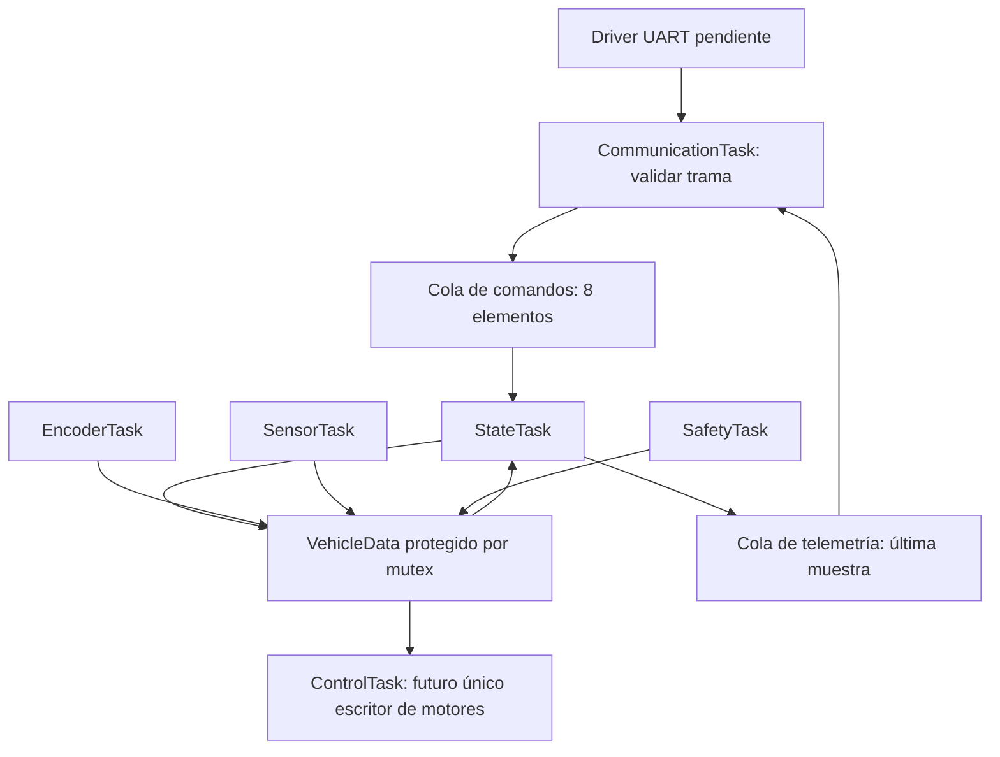

# Cómo leer y completar el esquema FreeRTOS

Esta es una base de organización para el firmware de alto nivel del auto.
Las tareas y sus esperas están implementadas; los drivers y la lógica de
movimiento quedan marcados con `TODO`. Se usa el FreeRTOS V10.0.1 que viene
con CIAA Software 1.1, sin modificar el SDK externo.

## Empezar de arriba hacia abajo

Leer primero `src/main.c`. Su trabajo es preparar el sistema:

```text
main()
  ├── boardConfig()          preparar la EDU-CIAA
  ├── app_resources_init()   crear datos, mutex y colas
  ├── app_tasks_create()     registrar seis actividades
  └── vTaskStartScheduler()  comenzar la ejecución de tareas
```

No se llama a las tareas desde un `while` en `main`. `xTaskCreate()` las registra
y el planificador decide cuándo ejecutar cada una. Cada tarea tiene su propio
`for (;;)`: trabaja una vez y llama a `vTaskDelayUntil()` para esperar su próxima
activación sin ocupar continuamente el procesador.

## Mapa de archivos

| Orden de lectura | Archivo | Qué vas a encontrar |
| --- | --- | --- |
| 1 | `src/main.c` | Arranque del sistema. |
| 2 | `src/app_tasks.c` | Las seis tareas y el lugar de cada responsabilidad. |
| 3 | `inc/app_config.h` | Períodos, prioridades y tamaño inicial de pilas. |
| 4 | `inc/app_model.h` | Comandos, mediciones, estado y telemetría. |
| 5 | `src/app_rtos.c` | Creación de recursos y acceso a datos compartidos. |
| 6 | `inc/FreeRTOSConfig.h` | Configuración del kernel, memoria e interrupciones. |
| 7 | `src/app_hooks.c` | Tick de sAPI y detección de fallas del RTOS. |

Las tareas están juntas para poder ver el esquema completo. Cuando crezca la
lógica, extraer PID, odometría, protocolo, seguridad y máquina de estados a
módulos propios: las tareas deberían coordinar esas funciones, no contener
todo el algoritmo.

## Tareas previstas

Un número mayor significa mayor prioridad de **tarea**. No son las prioridades
NVIC de las interrupciones del microcontrolador.

| Tarea | Período | Prioridad | Responsabilidad pendiente |
| --- | --- | --- | --- |
| Safety | 10 ms | 5 | Fallas, antigüedad de datos, obstáculos y permiso de movimiento. |
| Encoder | 2 ms | 4 | Adquisición a través de los drivers y movimiento medido. |
| Control | 5 ms | 3 | Consignas por lado, PID, límites y rampas; salida a motores. |
| Sensor | 20 ms | 2 | Recoger distancias; ultrasónico trasero solo en reversa. |
| Communication | 20 ms | 2 | Recibir/validar tramas y enviar telemetría. |
| State | 50 ms | 1 | Estados, transiciones y rearme; producir una instantánea de telemetría. |

Los períodos vienen de la propuesta del informe. La jerarquía numérica es una
propuesta inicial: todavía no demuestra que se cumplan los tiempos requeridos.
Hay que medir tiempos de ejecución y respuesta en la placa, y revisar las
prioridades al integrar los drivers. Las pilas empiezan con 256 palabras
(1024 bytes) por tarea; deberán medirse y ajustarse al agregar algoritmos.

## Cómo se comunican



- **Mutex:** `app_data_lock()` obtiene acceso a `VehicleData`;
  `app_data_unlock()` lo devuelve. Copiar o modificar datos y liberar enseguida.
  Hacer cálculos y llamadas a drivers fuera del mutex. No conservar ni usar
  el puntero a los datos después de liberarlo.
- **Cola de comandos:** está creada y StateTask la consume, pero no tiene un
  productor real. Al implementar RX, solo enviar comandos validados y marcar
  `received_at` al recibir/validar la trama. El formato de comandos PC → CIAA
  todavía está pendiente.
- **Cola de telemetría:** StateTask publica una copia completa cada 50 ms
  (20 Hz). Se guarda la más reciente y CommunicationTask la retira en su
  próximo ciclo. La trama CIAA → PC acordada para velocidades de ruedas tiene
  10 bytes: `sync` (2), `timestamp_ms` monotónico (4), velocidad medida
  izquierda (int16, mm/s, con signo) y derecha (int16, mm/s, con signo). No
  incluye versión, estado ni CRC. Falta fijar los bytes concretos de `sync`,
  el endianess y serializar/transmitir la trama por UART. El receptor conserva
  la última muestra completa recibida.

La PC convierte las velocidades medidas de ambas ruedas en velocidad lineal y
angular del vehículo y construye `nav_msgs/Odometry` para el EKF. El encoder
óptico no detecta sentido: el signo transmitido se infiere del sentido de la
última orden aplicada a cada motor.

Las colas de FreeRTOS ya sincronizan sus operaciones; no hay que tomar el mutex
de `VehicleData` para enviar o recibir en ellas. El mutex actual solo puede
usarse desde tareas. Cuando se integren ISR, el responsable de drivers debe
acordar prioridades NVIC y usar exclusivamente APIs `FromISR` permitidas.

## Qué hace hoy y qué falta

Hoy arranca en INICIO y StateTask pasa a ESPERA. No hay otras transiciones.
SafetyTask calcula si falta un comando o si pasaron 300 ms desde su recepción,
pero mantiene la parada solicitada permanentemente. ControlTask mantiene
ambas salidas propuestas en cero y no llama a un driver. Los sensores y
encoders publican muestras inválidas; no se inventan mediciones útiles.

El LED azul se alternaría cada 500 ms si StateTask está ejecutándose en la
placa. No demuestra el cumplimiento temporal ni la salud del resto de tareas.
El LED rojo queda fijo si se detecta una falla de creación, assert, falta de
heap o desborde de pila. La compilación fue verificada; estos indicadores
todavía no se probaron en hardware.

**No es un firmware de conducción ni una parada de emergencia implementada.**
Antes de conectar actuación real hay que completar los permisos y el rearme,
la validación de datos y el apagado de motores independiente de tareas/mutex
en `app_fatal()`. Tampoco se configura la UART, se hace PID, se calcula
odometría ni se cargan binarios a la placa desde esta base.

## Orden sugerido para completar

1. Entender el recorrido desde `main` hasta StateTask y sus esperas.
2. Acordar con Tomás el contrato de drivers: unidades, signos, antigüedad,
   errores y tiempos máximos de cada llamada.
3. Implementar comandos y transiciones con entradas de prueba identificadas
   como tales, manteniendo los motores desconectados del software.
4. Definir pérdida de comunicación, parada y rearme. El timeout de 300 ms es
   preliminar: al tiempo de detección se suman planificación y actuación.
5. Integrar mediciones, calcular consignas, implementar PID y odometría.
6. Integrar sensores y UART y medir funcionamiento y tiempos reales.

No usar `delay()` de sAPI para esperar en las tareas: usar esperas de FreeRTOS.
El tick del kernel a 1 kHz mantiene el contador de sAPI con `tickerCallback()`;
no reconfigurar SysTick con `tickInit()` ni instalar callbacks bloqueantes.

Compilar desde la raíz del repositorio con `make` o Ctrl+Shift+B. Al cambiar
`app/config.mk`, ejecutar `make clean` antes de compilar.
